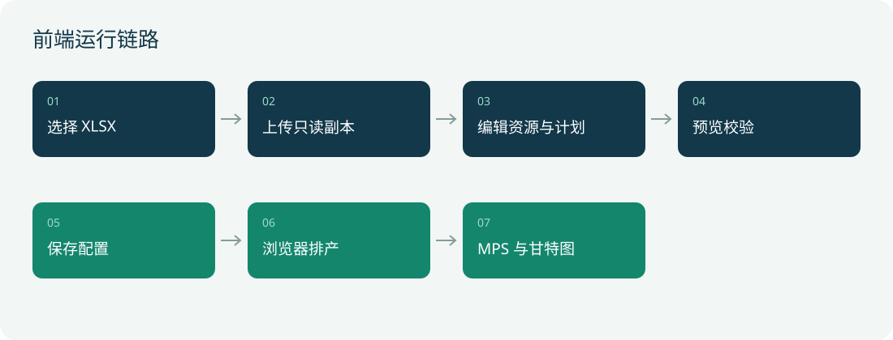
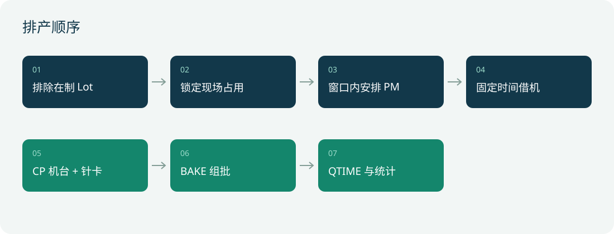

# XMC 测试排产前端技术文档

版本日期：2026-11-03。本文面向前端开发、算法维护和现场联调人员，说明当前代码的页面结构、数据流、排产规则及部署边界。当前算法运行在浏览器，不在 Python 服务端求解。

## 1 技术结构

原生 HTML、CSS、JavaScript，无构建依赖。使用 `window.TSApp` 管理界面状态，`window.TestingScheduler` 提供同步排产引擎。图表为 SVG，甘特图为 Canvas。必须通过 Python 服务访问，才支持文件上传和持久化配置；静态模式只展示内置算例。

| 文件 | 责任 |
|---|---|
| `frontend/index.html` | 页面骨架、导航、弹窗、脚本加载顺序 |
| `assets/styles.css` / `assets/enterprise.css` | 基础样式、XMC 深蓝与绿色视觉、移动端断点 |
| `assets/data-loader.js` | 请求 API；静态服务返回 404 时使用内置数据，服务端错误不伪装为成功 |
| `assets/js/core.js` | 状态、启动、导航、触发排产 |
| `assets/js/diagnostics.js` | 同源提交运行记录、诊断卡片、前后对比与最近记录 |
| `assets/js/configuration.js` | 文件上传、机台与计划编辑、保存、推荐、Oracle 预留配置 |
| `assets/js/mps.js` | MPS 对比、产品筛选、累计周图 |
| `assets/js/gantt.js` | CP、BAKE、PM、借机和在制占用绘制 |
| `assets/js/inputs.js` | 有效数据预览、字段映射、核验 |
| `assets/js/ui.js` | 设置、详情抽屉、CSV 导出 |
| `assets/scheduler.js` | 资源日历、启发式调度与统计 |

## 2 页面与操作

界面分为 MPS 结果、排产甘特、数据配置、排产诊断四个入口。主界面保留关键数字，字段说明和低频配置使用折叠区。

- MPS：Excel MPS、算法完成、差额、在制另列；平台柱图和周累计图；点击产品查看路线。
- 甘特：按 CP / BAKE、平台、日期过滤；悬停显示任务；灰色表示在制或不可用资源。
- 配置：在“生产配置 → Excel 导入”选择 `.xlsx` 上传副本，编辑机台清单、PM、借机和在制，再点击“保存并排产”。静态模式只显示禁用入口和启动后端提示。
- 新文件不会自动替换已有资源覆盖；需要采用新文件资源时点击“恢复参考配置”。这会清空全部资源覆盖，包括手工在制快照，操作前应备份配置。
- 推荐只试排，不保存。借机推荐同 TYPE 机台；PM 不换机台，只推荐维护时间。
- 诊断：显示问题编号、内网明细和前后对比；没有诊断导出功能，与 MPS/排程 CSV 导出相互独立。

## 3 上传和保存

1. 从“数据配置 → Excel 导入”或页头“Excel 导入”打开文件选择控件；控件限制 `.xlsx`，客户端检查 20 MB 上限。入口仅在服务端模式可用。
2. 使用原始二进制 `POST /api/uploads`，文件名通过 URL 编码的 `X-Filename` 发送。
3. 服务端返回副本路径、原始文件名和 Sheet 列表。上传本身不激活数据源。
4. 点击保存，先请求 `/api/preview`，检查计划冲突并试排。
5. 请求 `/api/config` 持久化，收到成功响应后替换前端数据，再排产并刷新当前视图。

外部原文件不修改；本系统只保存配置和上传副本。页面未保存的编辑不是有效排程。切换页面目前会重新渲染，未保存草稿可能丢失，应先保存。

## 4 排产规则

| 对象 | 当前实现 |
|---|---|
| Lot | 所有在制 Lot 整体排除；其余 Lot 可重新分配机台和时间 |
| 机台 | Platform 映射 TYPE；LOST 禁用；RUN 无快照则机台和安装针卡暂停分配 |
| CP | 周目标、交期、减少换卡、短工序策略排序；机台与同 TYPE 候选针卡同时可用 |
| 针卡 | 物理卡互斥；换卡默认 5 分钟；安装位置为简化状态，不是完整事件仿真 |
| PM | 固定机台，Early 当日 00:00 起，Over 当日结束前完成；选择最早空档；显式 start 则固定时间 |
| 借机 | 按 start，否则 generatedAt，否则 DATE 当日 08:00；不延期，冲突标记未执行；保存冲突配置会被拒绝 |
| BAKE | 同 Recipe 组批；每腔最多 4 Lot、50 片；默认等待窗口 8 小时；同设备 PM 同步阻塞全部腔体 |
| QTIME | 分钟等待，不占资源；等待结束才计完成 |
| 推荐 | 借机逐台试排，先月内完成量，再周按期率，再换卡次数；不是全局最优搜索 |

数据中的 `flows` 当前被解析为 CP1…CPn、BAKE、QTIME 顺序，不能支持任意交替路线。CP 的 TIME 为分钟/lot，BAKE 为小时/批，QTIME 为分钟。

## 5 指标口径

`差额 = 算法月内完成 Lot 数 − Excel MPS`；`达成率 = 算法完成 / Excel MPS`。在制单列，不补加到算法完成量。每个产品按最终完成时间不晚于下月 1 日 00:00 计入月内完成。周目标使用累计完成量；在制也不计入本次周完成。

MPS 是对比基准，不是求解器硬性保证。启发式方案有缺口，只表示当前方案未达成，不能证明现场问题无解。无法匹配资源的 Lot 不输出无限时间任务，而是计入未排数量。

## 6 Oracle 扩展

配置区预留 host、port、service、user、passwordEnv 和业务视图映射。`POST /api/oracle/config` 只保存设置，不连接数据库，也不切换当前 Excel。密码不在浏览器输入或 JSON 中保存。未来 Oracle 适配器须返回与 Excel 一致的标准化契约，界面和引擎无需直接依赖数据库驱动。

## 7 现场部署准备

| 风险 | 准备事项 |
|---|---|
| 月初全空闲、全天运行假设 | 提供现场快照时刻、班次、节假日、已完工和剩余需求数据 |
| 工时波动、良率与重测 | 采集实际工时分布、重测路径和产出计量口径 |
| 复杂路线 | 扩展为通用工序依赖图，覆盖重复 CP / BAKE 与分支 |
| 资源移动 | 增加针卡搬运安装事件、人员限制和真实兼容性 |
| 规模与卡顿 | 当前同步求解占主线程，大规模应迁至 Web Worker 或服务端任务 |
| 多人协作 | 增加版本校验、草稿保护、审计和排程确认发布；当前后保存覆盖先保存 |

目前仍按月份起点排新任务，没有“从现场当前时刻只排未来”的滚动排产机制。在制仅保留已填写的当前占用，不推算该 Lot 后续资源需求。正式上线前这两项必须联调。

## 8 验证与品牌

`tests/scheduler.test.js` 包含在制排除、CP/针卡互斥、BAKE 占用、LOST、RUN 缺快照、PM 窗口、借机不延期及产能缺口测试。加载 `scheduler.js` 后执行该文件，结果在 `globalThis.schedulerTestResults`。

Logo 来自 XMC 官网高清源，原图 2865×456，显示窗口仅展示 XMC 图形、不显示公司名称文字。来源与显示比例见 `frontend/assets/brand/README.md`。装饰晶圆 SVG 是项目绘制，并非官方品牌图形。

## 9 内网排产诊断

新增“排产诊断”导航。每次成功或失败的排产通过同源 `/api/runs` 保存输入快照、策略和简化结果，服务端独立检查资源重叠、工序衔接、PM 窗口、借机冲突、在制重排、BAKE 容量等。界面展示固定问题编号、证据明细、最近运行和与上次的完成量变化，不提供导出或对外发送。

反馈示例：`diag-1｜R01｜新增计划`。不包含产品、机台、时间或数量明细。用户仍应按企业制度确认是否允许沟通通用现象。详情仅在内网页面查看；每类最多显示 20 条证据。

“已确认”表示检查到的现象，不表示已确定根因；“待核查”需要人员检查。输入变化后的完成量下降不能直接判定为算法缺陷。诊断失败不会把成功排产变成失败，页面会提示记录未保存。静态模式不保存诊断。

## 10 跨平台访问与联调

Windows 双击根目录 `一键启动.bat`，Linux/macOS 执行 `bash 一键启动.sh`。启动前会校验前端入口、静态资源和后端数据契约，启动后确认首页、`/api/health`、`/api/data` 均可用。桌面环境自动打开本机地址；SSH/无界面服务器打印地址后手动访问。客户端无需安装 Python；Python 只安装在运行后端的服务器上。完整流程见 [部署说明](../../部署说明.md)。

服务器本机使用 `http://127.0.0.1:8080`，其他电脑使用 `http://服务器IP:8080`。上传、配置保存、诊断均走相同来源的 `/api/*`，不需要前端另行配置服务器 IP。部署到子路径时需同步配置 `window.APP_BASE` 和代理规则，当前一键启动按站点根路径部署。

验收应覆盖文件选择、保存后刷新、重新排产、诊断记录刷新、停止和重启；直接打开 HTML 或 Live Server 不构成前后端联调。Windows 原生进程管理尚未实机验收，不能将语法及单元测试通过等同于目标服务器部署成功。
