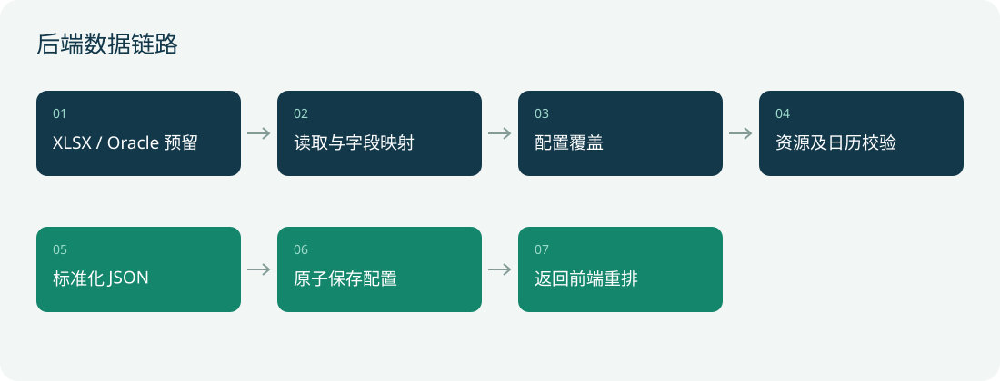
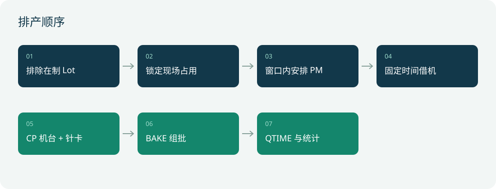

# XMC 测试排产后端技术文档

版本日期：2026-11-03。本文面向后端开发、运维和 Oracle 联调人员，说明 Python 服务的数据接入、校验、持久化、接口及上线要求。后端不执行排产求解；负责标准化数据和配置管理。

## 1 架构与模块



| 模块 | 职责 |
|---|---|
| `backend/server.py` | ThreadingHTTPServer、静态资源、API、上传及原子保存 |
| `backend/server_core.py` | Excel 字段映射、数据标准化、资源校验、计划日历校验 |
| `backend/data_sources.py` | Oracle 配置验证及未启用的适配器边界 |
| `backend/diagnostics.py` | 运行快照、独立规则核验、历史摘要及结果比较 |
| `deployment/manage.py` | 跨平台环境检查、后台进程管理、健康检查、Linux systemd 安装 |
| `deploy.sh` / `deploy.bat` | Unix / Windows Python 选择和管理入口 |
| `tools/build_data.py` | 标准库 ZIP/XML 读取 XLSX，支持共享字符串、日期样式和缓存公式值 |
| `config/config.json` | 当前数据源、字段映射、资源计划覆盖及 Oracle 配置 |
| `config/uploads/` | UUID 命名上传副本，不对外作为静态资源提供，已加入忽略规则 |

Excel 路径相对项目根目录解析。未配置的可选 Sheet 返回空列表；配置了名称却不存在时抛错。核心列映射不匹配时报错，不应默默读成空数据。公式不重新计算，只读取 XLSX 中缓存值。

## 2 接口契约

| 方法与路径 | 请求 | 响应与副作用 |
|---|---|---|
| GET `/api/health` | 无 | `{ok,time}` |
| GET `/api/config` | 无 | 当前数据源、映射、覆盖、Oracle 预留设置，不返回密码 |
| GET `/api/data` | 无 | 标准化数据和 planIssues，不写文件 |
| POST `/api/uploads` | XLSX 原始二进制，`X-Filename` 为 URL 编码文件名 | `{ok,path,name,sheets}`；存副本，不激活 |
| POST `/api/preview` | dataSource、fieldMap、scheduling 的配置对象 | `{ok,data}`；校验，不保存 |
| POST `/api/config` | 同预览 | 拒绝计划冲突，原子保存，返回 `{ok,data,config}` |
| POST `/api/oracle/config` | host、port、service、user、passwordEnv、views | 只保存，返回 `status: reserved`；不连接、不切换来源 |
| POST `/api/runs` | input、options、result、trigger、可选 error | 内网保存快照并返回独立诊断 report，最大 40 MB |
| GET `/api/runs` | 无 | 最近 20 次摘要及证据，不返回完整快照 |

一般验证错误返回 HTTP 400 和 `{ok:false,error}`；跨来源写请求返回 403；数据读取错误返回 500。JSON 为 UTF-8。请求对象按顶层替换，`scheduling` 不是逐条补丁。保存 `{scheduling:{}}` 表示恢复 Excel 资源计划，删除所有手工覆盖。

## 3 XLSX 上传

客户端发送示例：

```javascript
fetch('/api/uploads', {
  method: 'POST',
  headers: {'Content-Type': 'application/octet-stream',
            'X-Filename': encodeURIComponent(file.name)},
  body: file
});
```

只接收 `.xlsx`，上传上限 20 MB；ZIP 最多 3000 项、展开总量不超过 100 MB，必须存在 `xl/workbook.xml`。使用 UUID 文件名，原名只用于显示，不能控制存储目录。解析失败删除本次副本。上传成功但未保存的文件目前不会自动清理，应由运维增加保留期和引用检查。

## 4 标准化数据

| 字段 | 结构及作用 |
|---|---|
| meta | month、start（+08:00）、days、source、loadedAt |
| mps | `[{platform,ppn,mps}]`，正式对比基准 |
| eqp | `[{id,type,card,recipe,status}]`，status 为空/RUN/LOST |
| flows | `{PROD:[[step,recipe,time],...]}` |
| recipes / cardType / platformType | Recipe 候选卡、卡类型、平台对应设备类型 |
| lots | 数组行，次序由 lotFields 描述 |
| pm / borrow | 固定机台维护窗口、固定开始时间借机 |
| wip | `[{lotId,eqp,chamber,card,start,end}]`；等待可只填 lotId |
| bakeResources | `{machines,chambers}`；每台统一腔体数 |
| planIssues | 已发现的资源日历冲突文字列表 |

`scheduling` 内存在的 eqp、pm、borrow、platformType、cardType 会覆盖 Excel 对应整组数据；wip、bakeResources 使用独立配置默认值。可选 `sheetMap.wip` 配合字段映射读取现场在制表，但配置覆盖优先。

## 5 持久化与校验



资源验证包括机台编号唯一、状态合法、安装针卡 TYPE 一致、物理卡不重复安装、在制 Lot 存在且唯一、占用结束晚于开始、针卡/机台占用不重叠、BAKE 在制批次不超 4 Lot/50 片、PM 窗口及计划机台存在。

`calendar_issues` 先锁在制和不可用资源，再固定机台安排 PM，最后逐条检查借机。PM 选最早可用时间；显式 start 不移动。借机不延期，与 PM 冲突不允许保存。预览返回冲突供界面修正，正式保存拒绝冲突。

保存由进程内锁串行化：读取配置 → 替换字段 → 构建数据 → 校验 → 同目录临时文件 → flush/fsync → `os.replace`。失败保留原配置。只支持单进程文件锁，多进程/多节点需共享存储事务或数据库。当前无配置版本控制，两个用户同时编辑仍可能发生后保存覆盖。

## 6 Oracle 预留设计

```json
{
  "host": "db.internal",
  "port": 1521,
  "service": "MES",
  "user": "readonly",
  "passwordEnv": "ORACLE_PASSWORD",
  "views": {"mps": "MES.V_MPS", "eqp": "MES.V_EQP"}
}
```

当前无需安装 Oracle 驱动，不尝试联网。`read_oracle` 明确抛出“尚未接入”，不会将失败伪装为 Excel 成功。表/视图名限制为标识符，接口不接受 SQL，密码字面值不允许保存。

后续接入工作：确认 Oracle 版本、驱动和网络；配置最小权限只读账号；从环境变量取密码；实现连接池、超时、绑定参数、只读视图查询、一致性快照和增量标识；把结果转换为 Excel reader 相同的 `(sheetName, rows)` 契约。还需明确刷新按钮/周期、覆盖优先级和数据库快照时间，再启用来源切换。

## 7 部署与安全

```bash
./run.sh
# 或
python3 backend/server.py --host 127.0.0.1 --port 8080
python3 -m unittest discover -s tests -v
```

当前是标准库演示服务，未提供登录、权限、审计或 TLS，不应直接暴露公网。上线需反向代理、企业身份认证、写接口权限、请求限流和备份。配置读接口含服务器路径和数据库拓扑，应限制访问；`/config.json` 兼容静态路径同样要封禁。跨来源检查仅是附加限制，不是认证措施。

本地路径及 HTTP Excel URL 只允许受信管理员配置；生产应限制可读目录和远端域名，防止任意文件读取或服务端请求伪造。上传限额还应在代理层同步设置。数据库和 Excel 均不回写业务数据。

## 8 验证与上线门槛

`tests/test_configuration.py` 检查上传副本、配置预览不落盘、保存重读、校验失败保留配置、跨来源拒绝、Oracle 设置保存及密码拒收，并对原始 Excel 做 SHA-256 一致性验证。

上线前必须补充实际业务数据验收：日期/时区、已完工与在制口径、工艺路线覆盖、班次、停机、针卡兼容、Oracle 视图字段、并发保存、异常恢复、上传清理和权限测试。当前后端仅验证约束和数据，不保证启发式排程最优或月度 MPS 必然达成。

## 9 内网运行记录和独立诊断

模块为 `backend/diagnostics.py`。`POST /api/runs` 接收 input、options、result、trigger 和可选 error，限 40 MB；生成北京时间运行编号、诊断版本、输入/输出 SHA-256、规则结果及前后对比，原子保存到配置目录下 `runs/`。`GET /api/runs` 返回最近 20 次摘要及诊断证据，不返回完整快照。目录不作为静态目录开放，也没有快照下载端点。

图示：浏览器排产 → 同源运行快照 → 后端独立核验 → 内网文件记录 → 诊断卡片及简短问题编号。

| 编号 | 检查 |
|---|---|
| R01 / R02 | 机台或腔体重叠 / 针卡重叠 |
| R03 / R04 | 工序衔接或 QTIME 不足 / PM 越窗 |
| R05 / R06 / R07 | 借机冲突 / 在制被重排 / BAKE 超容量 |
| C01 / C02 | 无可用资源待核查 / RUN 缺快照 |
| P01 / P02 | 当前月度未达成 / 比上次完成量下降 |
| S01 / S02 / S03 | 排产失败 / 超过 5 秒 / 同输入策略结果变化 |

运行记录包含真实业务数据，只存内网，不脱敏、不出网。生产需为该目录配置权限、磁盘配额、保留期和备份；目前不自动删除。诊断版本为手动维护版本标识，修改算法或诊断逻辑时应更新。相同输入对比只搜索最近 20 次；不提供自动回放入口，目前保存快照供内网后续开发使用。结果由客户端提交，独立校验用于调试，不等于可信执行证明。新增测试为 `tests/test_diagnostics.py`。

## 10 一键部署

上传完整 Testing 目录后执行 `bash 一键启动.sh`，入口调用 `deploy.sh` 和 `deployment/manage.py`。自动选择 Python、验证输入及写权限、检查端口、后台启动并访问健康端点。无第三方依赖，不下载安装包。后台运行管理使用 `bash deploy.sh status/logs/restart/stop`；Linux systemd 可选 `install-service`，需 sudo，只安装服务不开放防火墙。详细步骤与限制见根目录 `部署说明.md`。本地 macOS 已验证启动、健康检查、状态查询和停止；systemd 安装尚需 Linux 现场验证。

### Windows 原生入口

新增 `deploy.bat` 和中文启动/停止/重启 BAT，使用 CRLF 行尾及 ASCII 脚本内容。自动选择 Python，启动采用 DETACHED_PROCESS 和 CREATE_NEW_PROCESS_GROUP。PowerShell CIM 核对命令行及创建时间，停止使用 taskkill，仅作用于已核验进程。启动成功自动打开本机浏览器。Windows 尚未实机验收；进程身份逻辑有单元测试，macOS 启停回归通过。Windows 不支持 install-service，不会自动安装 Python 或开放防火墙。

### 运维契约

Python 最低版本为 3.9。Windows 还需 PowerShell/CIM；Unix 需 Bash/ps。所有入口最终调用同一管理模块，默认使用 config 中的 HOST/PORT，支持环境变量 `HOST`、`PORT`、`CONFIG`、`PYTHON_BIN` 覆盖。Windows 可搜索 `runtime/python/python.exe`，但项目不分发运行时。未支持 Windows 系统服务或任务计划自动安装。

`.runtime/process.json` 记录 PID、配置路径、地址、端口；Windows 另存创建时间。此目录是本机运行状态，不能随代码复制到其他服务器。后台日志位于 `.runtime/server.log`，不会自动轮转。上传副本和诊断不自动过期，生产需设置磁盘监测和内网保留策略。

完整安装、验收、端口及故障处理见 [部署说明](../../部署说明.md)。`tests/test_deployment.py` 验证 Windows PID 复用拒绝和失效记录查询不调用 `os.kill`。正式交付前仍须在目标 Windows/Linux 环境完成启停、断开终端、权限、防火墙和服务器重启后的验收。
